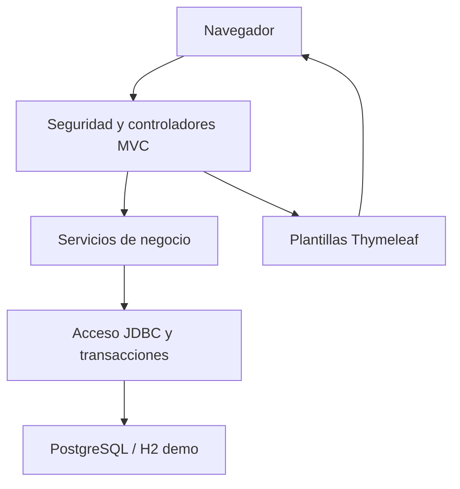
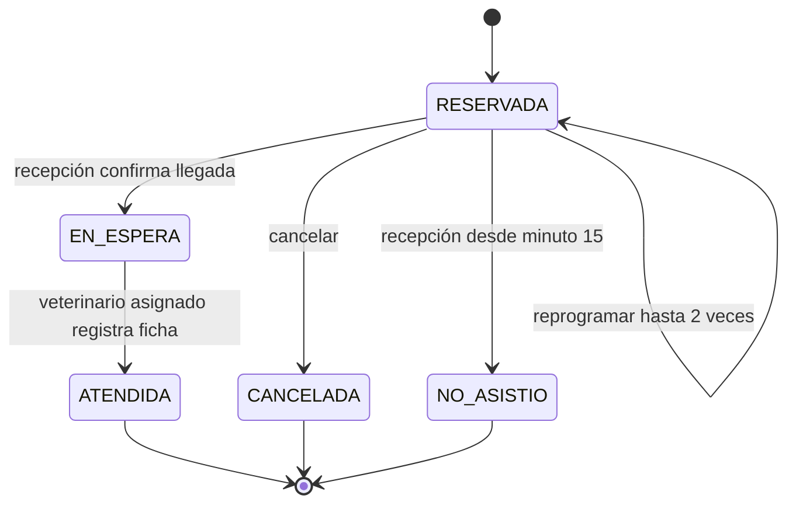

# Diseño técnico

La aplicación es un monolito con vistas Thymeleaf y persistencia relacional. Cada operación se valida en servidor. Spring Security protege rutas, sesión, CSRF, contraseñas BCrypt y permisos por rol; los servicios validan además propiedad de mascotas y asignación de veterinarios.

## Responsabilidades

| Componente | Responsabilidad |
|---|---|
| AgendaService | Horarios, feriados, anticipación y disponibilidad |
| CitaService | Reserva, reprogramación, cancelación, llegada, atención y estado |
| InasistenciaService | Ventana de 90 días y bloqueo de reserva en línea |
| UsuarioService | Registro, validación, mascotas y activación de usuarios |
| Store | Consultas JDBC, identificadores generados y auditoría |
| ThemeService | Opciones visuales permitidas y CSS de ajustes |
| SecurityConfig | Autenticación, bloqueo tras cinco fallos, autorización y cabeceras |
| ActiveAccountFilter | Revocación de sesión cuando se desactiva una cuenta |
| WebController | Conversión de entradas HTTP y selección de vistas |
| ThemeController | CSS del tema global y extensión local |

## Estados de una cita

La reprogramación mantiene el ID y aumenta el contador. Se registran cambios de estado y de agenda en `audit_event`. No existe una ruta que vuelva a abrir un estado final. El historial usa una ficha única por cita (`clinical_record.appointment_id UNIQUE`).

## Concurrencia

Reserva y reprogramación usan transacciones. Antes de comprobar disponibilidad se bloquea la fila del veterinario y después la de la mascota mediante `SELECT FOR UPDATE`. Todas las escrituras de agenda siguen ese orden. La consulta detecta conflictos en el mismo bloque por cualquiera de los recursos. Una prueba lanza dos reservas simultáneas y verifica que solo una se guarda.

## Tema público

El contrato visual son las variables `--va-*` de `tokens.css`. `app.css` contiene el layout adaptable; los ajustes permitidos se almacenan como pares clave/valor en la base. La última capa es un `custom.css` editable por el mantenedor. Los IDs y atributos de formularios son estables y no dependen del tema.

## Datos

`app_user` tiene mascotas; una cita referencia mascota, veterinario y servicio. Una cita atendida tiene una ficha clínica. `business_hours` y `holiday` determinan la agenda. Los campos clínicos se muestran escapados como texto. El sistema usa hora civil de Lima (`Clock` inyectable), coherente con la única sede local del alcance.

Los veterinarios y servicios se desactivan para nuevas reservas y se mantienen las referencias históricas. El rol de una cuenta interna es fijo tras su creación en esta versión; administración gestiona altas y activación. Los propietarios de mascotas se conservan al editar sus perfiles.

## Límites conocidos

La consulta de disponibilidad valida los bloques sucesivamente; conviene medirla con JMeter en el equipo final antes de concluir sobre rendimiento. Los listados no tienen paginación en esta primera versión. No se han medido los RNF de rendimiento, usabilidad ni recuperación en el equipo de presentación.
